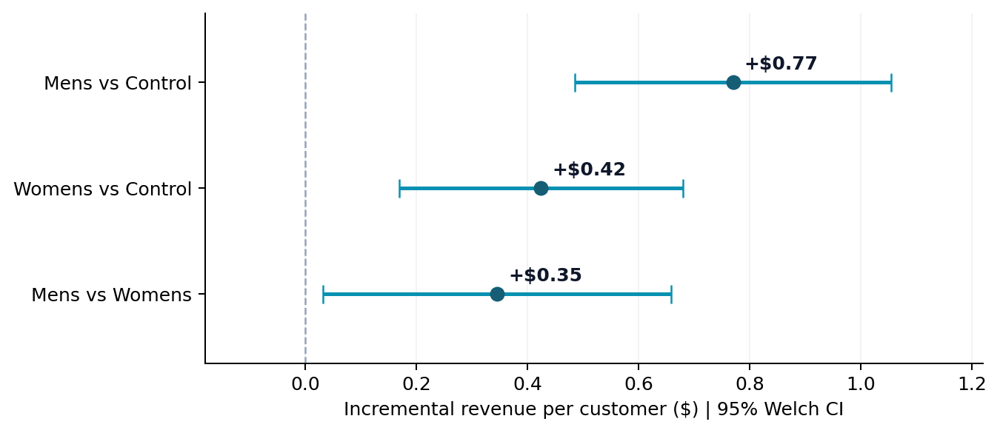
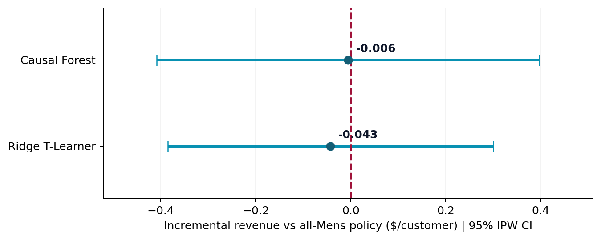

# Causal Marketing Optimization: Evidence Before Personalization

**Final analytical report | Hillstrom MineThatData E-Mail Experiment | November 2026**

**Research question.** Which email campaign produces the greatest *incremental revenue per customer*, and can customer-level uplift models produce better decisions than sending the same campaign to everyone?

> **Executive decision:** The men's-product email is the strongest **observed average-revenue policy** in this randomized experiment. The tested personalized revenue policies did **not demonstrate a statistically reliable improvement** over sending the men's-product email to every eligible customer. This is a finding about evidence and decision-making—not proof that treatment effects are identical or that personalization can never work.

## 1. Executive summary

- Analyzed **64,000 customer records** allocated across No E-Mail (21,306), Mens E-Mail (21,307), and Womens E-Mail (21,387).
- The average revenue per assigned customer was **$0.6528** for control, **$1.4226** for Mens E-Mail, and **$1.0772** for Womens E-Mail.
- **Mens vs Control:** **+$0.7698** in revenue per randomized customer (95% Welch CI **[$0.4851, $1.0545]**; two-sided p = **1.16 × 10⁻⁷**; Holm-adjusted p ≈ **3.49 × 10⁻⁷**).
- An exploratory interaction analysis found evidence that **conversion uplift varied by historical spending segment** (Holm p = **0.0326** within the three conversion-feature tests); analogous revenue heterogeneity was **not statistically significant** after correction (history_segment Holm p = **0.1582**).
- On the recorded 12,800-observation test split, the spending-based **Causal Forest** policy yielded **$1.3470** RPU, versus **$1.3526** for sending Mens E-Mail to everyone; paired IPW **Δ = −$0.0057** (95% CI **[−$0.4083, $0.3969]**, p = **0.9780**).
- The **Ridge T-Learner** policy yielded **$1.3101** RPU, paired IPW **Δ = −$0.0425** (95% CI **[−$0.3853, $0.3002]**, p = **0.8079**).

**Interpretation:** The average treatment effect is clear; the *incremental value of personalization* is not. Neither tested personalized policy had a statistically demonstrated revenue advantage over the simple Mens E-Mail strategy. Both policy confidence intervals are wide and include materially positive as well as negative values.

## 2. Dataset, estimand and quality audit

The dataset is Kevin Hillstrom's **MineThatData E-Mail Analytics Challenge**. Customers were allocated to either a men's-product email, women's-product email or no email. The principal outcome, `spend`, is customer spending in the **two weeks after** assignment; `conversion` records whether a purchase occurred over that period.

The primary estimand is the **intent-to-treat average difference in two-week revenue per assigned customer**. All assigned customers—including those with zero spending—remain in the denominator. This avoids selection on post-treatment outcomes such as `visit` or `conversion`.

Pre-treatment fields used for heterogeneity and predictive modeling include `history`, `history_segment`, `recency`, `mens`, `womens`, `newbie`, `channel` and `zip_code`. The `mens`/`womens` indicators describe **historical merchandise purchases, not customer gender**.

| Quality check | Notebook finding | Decision |
|---|---:|---|
| Total observations | 64,000 | All retained |
| Missing values across 12 fields | 0 | No imputation |
| Invalid treatment assignments, negative values or invalid binaries (checked fields) | 0 | No exclusion |
| Extra exact-duplicate rows | 6,562 across 1,072 duplicate patterns | Retained; no unique customer identifier to verify duplicates represent the same customer |

The high concentration of identical records around historical spend of $29.99 and zero observed outcome could reflect distinct customers with common patterns. Deduplicating using treatment/outcome fields would be hard to justify. However, **retaining exact matches without unique IDs leaves a data-quality uncertainty**, not proof of unique individuals.

## 3. Experiment integrity and average treatment effects

**Sample ratio mismatch (SRM) check.** Against an assumed 1:1:1 allocation, Pearson's chi-square goodness-of-fit statistic was **0.2025**, p = **0.9037**. This shows no detected deviation, **not proof that randomization was implemented correctly**.

**Covariate balance.** Pairwise absolute standardized mean differences for `history`, `recency`, `mens`, `womens` and `newbie` were all below **0.009**. Chi-square balance p-values for categorical pre-treatment features were **0.3580** (`history_segment`), **0.5795** (`zip_code`) and **0.4580** (`channel`). Taken together, the diagnostics did not reveal meaningful assignment imbalances.

**Primary analysis.** Two-sided Welch t-tests compared mean revenue per *assigned* customer; three pairwise hypotheses were corrected using Holm's procedure (α = 0.05).

| Comparison | Δ revenue/customer | 95% Welch CI | Raw p-value | Holm p-value |
|---|---:|---|---:|---:|
| Mens − Control | **+$0.7698** | [$0.4851, $1.0545] | 1.16e−7 | **3.49e−7** |
| Womens − Control | **+$0.4244** | [$0.1690, $0.6799] | 0.001129 | **0.002259** |
| Mens − Womens | **+$0.3454** | [$0.0326, $0.6583] | 0.030469 | **0.030469** |

All three revenue comparisons were significant after Holm correction. The Mens E-Mail arm had the highest average RPU. **These are retrospective analyses of an existing randomized experiment; no new experiment was designed or deployed by this project.**

## 4. Variance reduction, calibration and sensitivity

**CUPED.** Historical spending had weak correlation with post-treatment revenue (**r = 0.0217**, R² = **0.0472%**). Using it as a CUPED covariate reduced pooled observed outcome variance from **226.0948** to **225.9880**—approximately **0.05%**. Treatment-effect standard errors changed negligibly.

**ANCOVA.** An HC3-robust outcome model adjusted for pre-treatment spending, recency, prior merchandise purchases, new-customer status, channel and location category. The notebook's residual-SSR comparison suggested **0.0926%** lower residual variation versus a treatment-only regression; individual treatment contrast standard errors declined by only **0.044%–0.115%**.

**A/A simulation.** Across **1,000** simulated three-way reassignments of control customers, with Holm-adjusted pairwise tests, the observed family-wise false-positive rates were **3.10%** (unadjusted Welch), **3.10%** (CUPED) and **3.30%** (ANCOVA). These checks assess approximate calibration of the simulated null procedure; they do not prove a specific model reduces variance or guarantee error control for later exploratory analyses.

**Power / MDE.** A retrospective normal approximation used a fixed conservative Bonferroni cutoff (0.05/3) to compare approaches, while the primary experiment tests used Holm. For Mens vs Control the original estimator had **80% MDE ≈ $0.4700/customer**, and the ANCOVA counterpart was **$0.4696/customer**. The practical difference was negligible. This is an approximate sensitivity calculation, **not a prospective power justification**.

**Methodological decision:** Keep the unadjusted, transparent Welch estimates as the primary experiment result; report CUPED and ANCOVA as robustness checks rather than claiming meaningful precision gains.

## 5. Exploratory heterogeneous treatment effects (HTE)

Customer subgroups were described using DuckDB SQL, and treatment-by-feature interactions were tested using an **HC3-robust OLS linear probability model** for conversion and an **HC3-robust OLS revenue model**. A joint Wald test checked all treatment interaction coefficients for each feature; Holm correction was applied across the three features **separately for each outcome**.

| Feature | Conversion: Holm p | Revenue: Holm p |
|---|---:|---:|
| `history_segment` | **0.0326** | 0.1582 |
| `zip_code` | 0.8539 | 0.6306 |
| `channel` | 0.7283 | 0.6306 |

Historical spending segments showed **evidence of conversion-effect heterogeneity**, but none of the three inspected features showed statistically significant *revenue-effect* heterogeneity after the within-outcome adjustment. In particular, the revenue interaction test for `history_segment` had an unadjusted p = **0.0527**; its Holm-adjusted p was **0.1582**.

The joint test does **not** establish which specific segment or alternative email is best. Subgroup rankings can be volatile, particularly in the smaller high-spend categories. Moreover, two outcomes and multiple exploratory comparisons were examined; the reported Holm correction does **not** control family-wise error across the entire analytic search. HTE alone is insufficient to establish that personalized assignment beats a universal Mens E-Mail policy.

## 6. Causal ML and off-policy evaluation

**Ridge T-Learner.** Three independent revenue regressions were trained, one per randomized arm. Numerical features were standardized and categories one-hot encoded inside an sklearn `Pipeline`; **five-fold CV** selected the Ridge penalty by mean-squared error. The candidate grid was **[0.1, 1, 10, 100, 1000]**, and all three saved models selected **1000**, the search-grid upper boundary; that choice is not evidence of a globally optimal penalty.

**Causal Forest.** The notebook trained an `econml.dml.CausalForestDML` with **300 trees**, **min_samples_leaf=200**, **max_depth=8**, `honest=True`, **three-fold nuisance cross-fitting**, a Ridge outcome nuisance model, and a treatment-assignment classifier. It estimated conditional revenue effects of Mens E-Mail and Womens E-Mail relative to no email. Models relied on **pre-treatment** features only.

Each policy recommended the action with the highest predicted revenue (T-Learner) or highest predicted incremental revenue versus no email (Causal Forest). To assess an action that was not observed for everyone, the notebook used an **inverse propensity weighted (IPW)** policy-value estimator, assuming three-way randomized assignment probabilities of 1/3:

\[ \widehat{V}(\pi) = \frac{1}{n} \sum_{i=1}^{n} \frac{\mathbf{1}\{A_i=\pi(X_i)\}\,Y_i}{1/3} \]

The policy comparison used **paired, customer-level IPW contributions** with a normal-approximation 95% CI and two-sided p-value. The reported test group contains **12,800 observations**. A 60/20/20 train/validation/test split was the intended workflow, but **the original saved notebook omits the actual split-generating cell**; see reproducibility notes below.

| Recorded test-set policy | Revenue/customer | Δ vs All Mens | 95% CI for Δ | Two-sided p |
|---|---:|---:|---|---:|
| **All Mens E-Mail** | **$1.3526** | Reference | — | — |
| Causal Forest policy | $1.3470 | **−$0.0057** | [−$0.4083, $0.3969] | **0.9780** |
| Ridge T-Learner policy | $1.3101 | **−$0.0425** | [−$0.3853, $0.3002] | **0.8079** |

**Interpretation:** The Causal Forest had almost identical estimated revenue to the universal Mens E-Mail policy, and the T-Learner estimate was slightly lower. **Neither difference was statistically distinguishable from zero.** These wide intervals do not establish policy equivalence; they also do not support claiming personalization reliably improves revenue.

## 7. Business recommendation

**Current recommendation:** Use **Mens E-Mail as the default revenue benchmark** based on the trial's arm-level results. Do **not** claim a demonstrated gain from deploying the tested personalized revenue policies. This is a decision under the available evidence, not a permanent finding that all customers should receive the same email.

A production decision should compare **incremental profit** rather than just revenue: email delivery costs, discounts, customer fatigue and longer-term retention are not included in this two-week dataset. New experiments could pre-register the revenue/profit outcome, reserve an untouched validation cohort, and randomize customers between a frozen personalized policy and the best universal policy. Consider doubly robust policy-value estimates and bootstrap uncertainty as sensitivity analyses, especially given heavy-tailed spending.

## 8. Limitations, reproducibility and integrity

1. **Exploration preceded final split discipline:** HTE analyses in the notebook queried the full dataset before the policy test was treated as held out, and multiple algorithms/metrics were compared. The recorded test results are therefore best described as **exploratory**, not strictly confirmatory.
2. **Notebook execution gaps:** The original upload contains results but omits saved `train_df`/`val_df`/`test_df` construction, references `conversion_preds` before its creation, and has a mismatch between `comparisons` tuple shapes and the ANCOVA SE loop. A patched companion notebook restores these cells, but it has **not been end-to-end re-executed** because the raw CSV was not uploaded with the notebook.
3. **Dataset ID and outcome variance:** No unique customer key makes exact duplicates ambiguous; revenue is zero-inflated/heavy-tailed, reducing the precision of normal-approximation IPW CIs.
4. **Assignment probabilities and scope:** The off-policy estimates assume known 1/3 assignment; the SRM diagnostic does not by itself establish the true experimental probabilities. Results concern a historic retailer and the two-week observation window; generalization to other populations or profitability is unproven.
5. **Selection bias and inference:** Subgroup and model choices were examined across multiple outcomes; nominal p-values should not be represented as a controlled confirmatory discovery process.

**Research integrity matters:** A null result is not a failed project. It demonstrates that an experimentally supported simple policy can be a sensible decision even when complex causal ML is available.

## Sources and tools

- Original source: Kevin Hillstrom, *MineThatData E-Mail Analytics and Data Mining Challenge* (2008), https://blog.minethatdata.com/2008/03/minethatdata-e-mail-analytics-and-data.html
- Dataset catalog: TensorFlow Datasets, https://www.tensorflow.org/datasets/catalog/hillstrom
- Causal forest implementation: EconML documentation, https://www.pywhy.org/EconML/_autosummary/econml.dml.CausalForestDML.html
- Analysis: Python, DuckDB SQL, pandas, NumPy, SciPy, statsmodels, scikit-learn, EconML, Matplotlib. All values above are transcribed from or directly calculated using numbers recorded in the supplied notebook; no new data were obtained for re-estimation.
