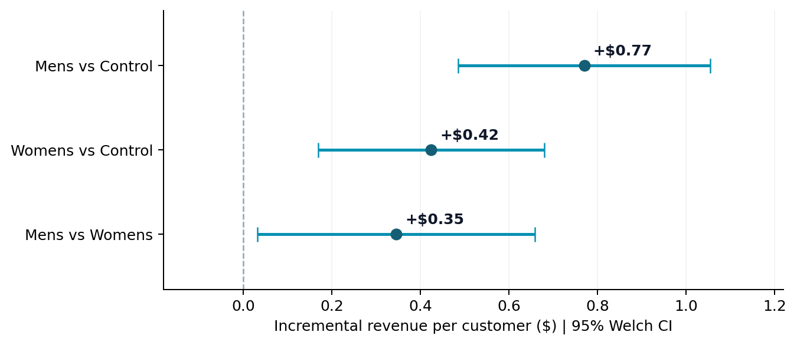
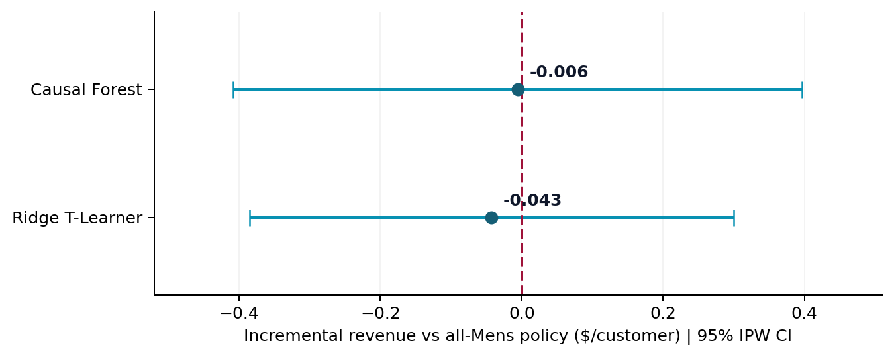

# Causal Marketing Optimization | A/B Testing → HTE → Uplift Policy Evaluation

**Python · DuckDB SQL · Statistical Inference · Causal ML · Off-Policy Evaluation**

> **Question:** Does personalized email targeting generate more *incremental revenue* than the best single campaign?
>
> **Answer from this analysis:** Mens E-Mail produced the largest experimentally observed average revenue. Two personalized revenue policies did **not show a statistically supported improvement** over sending Mens E-Mail to everyone. A simpler policy remains the evidence-supported benchmark.

## Key results

| Metric | Result |
|---|---|
| Randomized experiment | **64,000 customers; 3 arms** |
| Data/assignment audit | **0 missing fields; SRM chi-square p = 0.904** |
| Mens E-Mail vs control | **+$0.7698 revenue/customer** (95% CI **[$0.4851, $1.0545]**) |
| Conversion HTE by historical spend | **Holm-adjusted p = 0.0326** (exploratory) |
| Revenue HTE by historical spend | Holm-adjusted p = 0.1582 (not significant) |
| Test: Causal Forest vs all Mens | **−$0.0057/customer**, 95% CI **[−$0.4083, $0.3969]** |
| Test: Ridge T-Learner vs all Mens | **−$0.0425/customer**, 95% CI **[−$0.3853, $0.3002]** |



**Why this matters:** Statistically detectable HTE does not automatically imply that assigning different actions to different people beats a single strong campaign. The project prioritizes **decision validity, confidence intervals, and honest negative findings** over maximizing a model score.

## Project workflow

| Phase | Questions / methods |
|---|---|
| **01 · Experimental integrity** | DuckDB SQL quality checks; missingness, duplicates; sample ratio mismatch (SRM); covariate balance with SMD and chi-square |
| **02 · Average treatment effects** | Two-sided Welch t-tests, 95% CIs, Holm correction, revenue per randomized customer |
| **03 · Precision & calibration** | CUPED, HC3-robust ANCOVA, 1,000 A/A simulations, power and MDE sensitivity |
| **04 · Heterogeneous treatment effects** | SQL subgroup estimates, treatment interactions, robust joint Wald tests, within-outcome Holm correction |
| **05 · Personalized policies** | Five-fold-CV Ridge T-Learner, honest EconML Causal Forest; three treatment actions |
| **06 · Business evaluation** | IPW policy values, paired policy differences, 95% CI and significance testing against universal Mens E-Mail |

## Experimental results

The data contain three randomly assigned campaigns: No E-Mail, Mens E-Mail and Womens E-Mail. Outcomes (`visit`, `conversion`, `spend`) were measured over the two weeks after the intervention. **The primary metric is `spend` averaged over *all assigned customers*, including customers who did not purchase.**

| Arm | N | Mean revenue/customer | Conversion rate |
|---|---:|---:|---:|
| No E-Mail | 21,306 | $0.6528 | 0.5726% |
| Mens E-Mail | 21,307 | **$1.4226** | **1.2531%** |
| Womens E-Mail | 21,387 | $1.0772 | 0.8837% |

A three-comparison Welch analysis finds both email campaigns above control, with Mens E-Mail also above Womens E-Mail (all three Holm-adjusted p-values < 0.05). CUPED and ANCOVA provided **negligible** precision gains; their underwhelming performance is reported rather than omitted.

## Did personalization help?



The notebook's recorded test split contained 12,800 customers. Using paired inverse propensity weighting (assignment probability assumed to be 1/3):

| Policy | Estimated RPU | Difference vs send-all-Mens | 95% CI | p-value |
|---|---:|---:|---|---:|
| Send Mens E-Mail to everyone | **$1.3526** | Reference | — | — |
| Causal Forest | $1.3470 | −$0.0057 | [−$0.4083, $0.3969] | 0.9780 |
| Ridge T-Learner | $1.3101 | −$0.0425 | [−$0.3853, $0.3002] | 0.8079 |

**Conclusion:** We cannot demonstrate that the tested personalized policies outperform the best universal campaign. A non-significant difference is **not proof of equivalence**; the intervals still permit both gains and losses. See the full [final report](FINAL_REPORT.md) for interpretation, caveats and methods.

## Repository structure

```text
.
├── README.md
├── FINAL_REPORT.md
├── requirements.txt
├── notebooks/
│   └── hillstrom_inference.ipynb
├── assets/
│   ├── ate_estimates.png
│   └── policy_ci.png
└── data/
    └── [download public CSV here; git-ignored]
```

## How to run

1. Use Python 3.10–3.11 and create a virtual environment (EconML compatibility varies with Python and sklearn versions).
2. Install dependencies: `pip install -r requirements.txt`.
3. Download the public Hillstrom CSV from [the dataset creator's original challenge](https://blog.minethatdata.com/2008/03/minethatdata-e-mail-analytics-and-data.html) or find it via [TensorFlow Datasets' Hillstrom catalog](https://www.tensorflow.org/datasets/catalog/hillstrom).
4. Place the original CSV (whose name begins `Kevin_Hillstrom`) inside `data/`, or set the `HILLSTROM_CSV` environment variable to its local path.
5. Open `notebooks/hillstrom_inference.ipynb` and run cells from the beginning. The A/A simulation and causal forest may take longer than the summary statistics.

**Reproducibility disclosure:** The original user notebook was saved with missing intermediate split code, a broken ANCOVA contrast loop, and an undefined conversion predictions variable. The packaged notebook restores those missing steps and clears stale outputs, but **could not be re-executed against the original CSV in this environment because the CSV was not supplied**. Recorded figures in this README come from the supplied notebook. If a rerun produces differences, investigate versions and analysis choices; do not silently overwrite either set of results. For issues and patched-cell details, see [`REPRODUCIBILITY_NOTES.md`](REPRODUCIBILITY_NOTES.md).

## Assumptions and limitations

- The fixed 1/3 randomized treatment propensity is assumed, not independently verified by the SRM test.
- Historical spending covariates and outcomes are very weakly correlated; CUPED cannot be expected to yield large benefits.
- Spending is mostly zero and heavy-tailed; simple IPW normal CIs may be imprecise.
- Historical subgroup exploration preceded the cleanly separated policy test, and several models were tried; **policy comparisons should be treated as exploratory**.
- This study maximizes **two-week revenue**, not profit, long-term value or customer retention; no sending costs were modeled.
- There is no customer ID. Duplicate rows were retained, with the uncertainty documented.

## Main takeaway

The goal was not to build the most complex uplift model. It was to make a decision supported by randomized data, quantify uncertainty, and recognize when added ML complexity lacks proven value. **That is the practical role of experimentation and causal inference in product and marketing data science.**

**Data credit:** Kevin Hillstrom, MineThatData E-Mail Analytics Challenge (2008). This is an independent portfolio analysis, not a company deployment or original experiment design.
